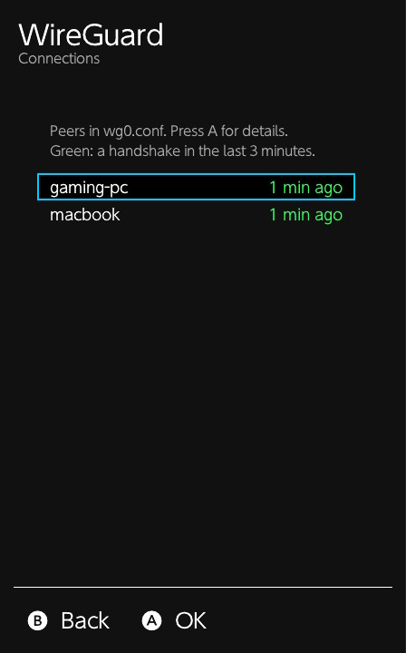

# wireguard-nx

[](https://github.com/UnderwaterOverground/wireguard-nx/releases/latest)
[](#license)
[](https://discord.gg/GjUuBEqRYb)

**WireGuard for the Nintendo Switch.** wireguard-nx runs in the background
on a Switch with Atmosphère and connects it to your own
[WireGuard](https://www.wireguard.com) server: the one on your router, NAS
or PC. Homebrew such as
[Moonlight](https://github.com/XITRIX/Moonlight-Switch) can then reach your
PC and the rest of your home network from anywhere, without opening ports
for each service.

> wireguard-nx is an unofficial, community project. "WireGuard" and the
> "WireGuard" logo are registered trademarks of Jason A. Donenfeld; this
> project is not affiliated with or endorsed by the WireGuard project or
> Nintendo.

## Features



- **Starts at boot** and stays connected in the background, through sleep
  and wake.
- **Homebrew reaches the tunnel:** apps launched from hbmenu can connect
  to the addresses in your WireGuard config (your server, and whatever
  networks it routes). Nothing to set up per app.
- **Plain WireGuard:** copy the `.conf` file any WireGuard server hands out
  (Unraid, wg-easy, OPNsense, MikroTik, `wg-quick`...) to the SD card.
  Pre-shared keys, several peers, host names as endpoints and persistent
  keepalives all work.
- **Peer names:** a `# Name = gaming-pc` comment in the config names a peer
  in the overlay and lets Moonlight find it by that name.
- **Overlay** (Ultrahand): status, the Switch's tunnel address, a pause
  switch, stop and start, a **Connections** page listing every peer with its
  last handshake, transfer and endpoint, and a **Config** page to switch
  between `.conf` files.
- **Update notice:** a notification at boot when a newer release is out
  (can be turned off).
- **Optional:** reach the Switch's [sys-ftpd](https://github.com/cathery/sys-ftpd)
  through the tunnel.
- **Small:** exactly 2.5 MB of memory, fixed when it starts.

## Before you start

You need:

- **A Switch with [Atmosphère](https://github.com/Atmosphere-NX/Atmosphere)**
  custom firmware. If you're not sure what that is, follow the
  [NH Switch Guide](https://switch.hacks.guide/) first. Tested with
  Atmosphère 1.12.0 on firmware 22.5.0 (Mariko).
- **[Ultrahand Overlay](https://github.com/ppkantorski/Ultrahand-Overlay)**.
  To check you have it, press **L + D-pad Down + R3** (R3 is pressing the
  right stick in) on the home screen: a menu should appear over the screen.
  You can do without it, but you'd miss the status screen and notifications.
- **A WireGuard server** you can add a peer to: the VPN built into many
  routers and NAS systems (Unraid, Synology, UniFi, OPNsense, pfSense,
  Fritz!Box, MikroTik), [wg-easy](https://github.com/wg-easy/wg-easy), or
  `wg-quick` on any Linux box. It needs to be reachable from the internet
  (a forwarded UDP port) if you want to use the Switch away from home.

## Install

### 1. Download

Open the [latest release](https://github.com/UnderwaterOverground/wireguard-nx/releases/latest)
and, under **Assets**, download **`wireguard-nx-<version>.zip`** (not "Source
code"). Unzip it. Inside are three folders: **`atmosphere`**, **`config`**
and **`switch`**.

### 2. Copy it to the SD card

Turn the Switch off (hold the power button, then **Power Options → Turn
Off**), take out the SD card and put it in your computer.

The SD card already has `atmosphere` and `switch` folders. The new files go
*inside* them, next to what's already there. Nothing on the card gets
deleted.

- **Windows:** select the three folders and drag them onto the SD card
  itself (not into a folder on it). If Windows asks about files with the same
  name, choose **Replace the files in the destination**.
- **Mac:** don't drag the three folders onto the card: Finder would
  *replace* your whole `atmosphere` folder instead of adding to it. Copy
  these two items one at a time instead:

  | From the zip | Drag it into this folder on the SD card |
  |---|---|
  | `atmosphere/contents/4200000000005747` | `atmosphere/contents` |
  | `switch/.overlays/wireguard-nx.ovl` | `switch/.overlays` |

  Folders starting with a dot are hidden on a Mac: press
  **Cmd + Shift + .** in Finder to show them. If Finder asks whether to
  replace an older version, choose **Replace**.

**Check it:** the SD card should now have these two files. If there's a
folder called `wireguard-nx-…` on the card, the files are in the wrong place:
move its contents out to the top of the card.

```
atmosphere/contents/4200000000005747/exefs.nsp
switch/.overlays/wireguard-nx.ovl
```

### 3. Add the Switch to your WireGuard server

On your server, add a new peer (often called a client or device) for the
Switch and download or copy its configuration. It's a short text file that
looks like this:

```ini
[Interface]
PrivateKey = <the Switch's private key>
Address = 10.253.0.2/32

[Peer]
# Name = gaming-pc
PublicKey = <the server's public key>
AllowedIPs = 10.253.0.1/32, 192.168.1.0/24
Endpoint = home.example.com:51820
PersistentKeepalive = 25
```

Two things worth checking in it:

- **`AllowedIPs`** says what the Switch reaches through the tunnel: the
  server's own tunnel address, and your home network if the server shares it
  ("remote access to LAN" on Unraid, "allowed IPs" elsewhere). A plain
  `0.0.0.0/0` works too (then all of homebrew's internet traffic goes
  through the server).
- **`PersistentKeepalive = 25`** keeps the tunnel open through NAT. Add it if
  it's missing.

Add a `# Name = ...` comment under `[Peer]` if you like: that's the name the
overlay shows, and the name Moonlight can use.

Save it as **`wg0.conf`** in the SD card's `config/wireguard-nx` folder
(create the folder if it isn't there), put the card back in the Switch and
turn it on as you normally would.

### 4. Check it's connected

1. Within a minute of the Switch connecting to Wi-Fi, a **"Connected. IP:
   10.x.x.x"** notification appears.
2. Press **L + D-pad Down + R3** to open Ultrahand and choose **WireGuard**.
   It shows **Connected** and the Switch's tunnel address. The
   **Connections** page lists your server with the time of its last
   handshake.

### It didn't work

- **No notification after a few minutes:** open the overlay. **Config
  error** names the line of the `.conf` it couldn't read. **Connecting...**
  with "No handshake yet" means the server didn't answer: check the
  endpoint and port (and that the port is forwarded if you're away from
  home), the keys, and that the server has the Switch as a peer.
- **There's no WireGuard in Ultrahand's menu:** `wireguard-nx.ovl` isn't in
  `switch/.overlays`.
- **Something else:** see [troubleshooting](docs/SETUP.md#troubleshooting).

### Updating

Download the new zip and copy it over the old files the same way. Your
configuration and settings are kept. Restart the Switch afterwards.

The [setup guide](docs/SETUP.md) covers setting up a peer on common servers,
several configurations, all the settings, sys-ftpd and more.

## Using it with Moonlight

Add your PC in Moonlight by its peer name (e.g. `gaming-pc`) or by an
address the tunnel reaches (its address on your home network, if the server
routes that network). At home, Moonlight may find the PC on the local
network and use that instead, which is fine. Away from home, it uses the
tunnel.

Use a name if you can. Our testing found these bitrates safe, at 60 FPS
with a worst-case picture (full-screen moving noise):

| Resolution | PC added by name | PC added by a `10.x`, `172.16.x` to `172.31.x` or `192.168.x` address |
|---|---|---|
| 720p | up to 25 Mbit/s | up to 20 Mbit/s |
| 1080p | up to 20 Mbit/s | not recommended: use 720p |

The name matters because Moonlight sends bigger video packets to addresses
that look local. Those are too big to go through the tunnel whole, so each
one is split in two, which doubles the work for the Switch. A name leads
Moonlight to a stand-in address instead (`100.127.0.1` for `10.253.0.1`:
the last two numbers are kept), which it treats as remote, so it sends
packets that fit, and wireguard-nx swaps the real address in on the way
out.

Peers are named by their `# Name = ...` comment. To name a PC elsewhere on
the server's home network, add a line like this anywhere in the `.conf`
(its address must be inside a peer's `AllowedIPs`), and add the PC in
Moonlight as `gaming-pc`:

```ini
# Host = gaming-pc 192.168.1.50
```

Set the bitrate in Moonlight's settings. Artemis picks 35 Mbit/s for 1080p,
so lower it to 20.

## Several configurations

Put more than one `.conf` in `config/wireguard-nx` (say `home.conf` and
`away.conf`) and pick one on the overlay's **Config** page. It switches at
once and stays the choice at the next boot.

## Known limitations

- **Homebrew only**: apps launched from hbmenu or another homebrew launcher,
  and home-screen forwarders (those with title IDs starting `01` need
  listing in `mitm_titles`, see the
  [setup guide](docs/SETUP.md#home-screen-forwarders)). Games and Nintendo's
  apps don't use the tunnel.
- **One tunnel at a time**, and the Switch connects to the server over
  **IPv4 only** (IPv6 addresses inside the tunnel work).
- **No DNS through the tunnel:** `DNS =` in the config is ignored. Peer
  names from `# Name = ...` comments resolve; other names don't.
- **Addresses on the Switch's own Wi-Fi network are reached directly**, not
  through the tunnel, even when `AllowedIPs` covers them (as on any
  computer: the local network is nearer). Away from home they go through
  the tunnel.
- To stop wireguard-nx while it runs, use **Stop** in its own overlay
  (close homebrew apps first). The Sysmodules overlay can't stop it: turning
  it off there takes a restart.
- Tested on one Mariko Switch. Reports from other models and firmware
  versions are welcome.

## Questions

**Does it affect games or online play?** No. It only handles traffic from
homebrew to the addresses in your configuration. It doesn't change how games
or Nintendo services connect, and Atmosphère's DNS blocking of Nintendo
servers is left in place.

**Can I use it with Tailscale?** That's what
[tailscale-nx](https://github.com/UnderwaterOverground/tailscale-nx) is
for. Both can be installed, but only one can serve homebrew at a time: turn
the other one off in Sysmodules.

**The console crashes (orange screen) when I wake it during a Moonlight
stream.** That's a Moonlight-Switch bug
([#306](https://github.com/XITRIX/Moonlight-Switch/issues/306)), and it
happens with wireguard-nx turned off too. Until it's fixed, end the stream
before putting the console to sleep.

**Artemis won't open a second time.** After a stream, Artemis can't start
again from the same hbmenu session, with or without wireguard-nx. Close
hbmenu from the HOME menu and open it again.

**Is my traffic private?** Traffic to the addresses in your configuration
is encrypted end to end with WireGuard, between the Switch and your server.
Nothing goes anywhere else: there's no account and no relay. The only other
connection wireguard-nx makes is the update check to GitHub, which you can
turn off.

**Something's wrong.** See [troubleshooting](docs/SETUP.md#troubleshooting).
For help, ask on [Discord](https://discord.gg/GjUuBEqRYb) or
[open an issue](https://github.com/UnderwaterOverground/wireguard-nx/issues).
Please include the log, `config/wireguard-nx/sysmodule.log` on the SD card.

## Building

See [docs/DEVELOPMENT.md](docs/DEVELOPMENT.md). Everything builds in Docker,
and most of it can be tested on a computer without a Switch.

## Credits

wireguard-nx is a fork of
[tailscale-nx](https://github.com/UnderwaterOverground/tailscale-nx), with
the Tailscale parts replaced by plain WireGuard. It builds on:
- **[tailscale-rs](https://github.com/tailscale/tailscale-rs):** Tailscale's
  Rust WireGuard implementation (`ts_tunnel`) and key types.
- **Libraries:**
  - [Atmosphère](https://github.com/Atmosphere-NX/Atmosphere)'s libstratosphere
  - [libnx](https://github.com/switchbrew/libnx)
  - [libtesla](https://github.com/WerWolv/libtesla)
  - [smoltcp](https://github.com/smoltcp-rs/smoltcp)
  - [rustls](https://github.com/rustls/rustls)
  - [RustCrypto](https://github.com/RustCrypto)
- **Ideas:** from [sys-GRID0](https://github.com/redluigi323/sys-GRID0),
  [ryu_ldn_nx](https://github.com/Ethiquema/ryu_ldn_nx) and
  [chrisbraucker's wireguard-nx](https://github.com/chrisbraucker/wireguard-nx),
  an earlier, unrelated project of the same name.

See [THIRD_PARTY_NOTICES.md](THIRD_PARTY_NOTICES.md) for licences.

## License

- **The project** is licensed under the GNU General Public License v2.0 or
  later ([LICENSE](LICENSE)). This covers the sysmodule, the overlay and the
  socket layer, which link GPL-2.0 libraries.
- **The Rust engine** in `crates/` is licensed under the BSD 3-Clause
  License ([crates/LICENSE](crates/LICENSE)), like the tailscale-rs code it
  builds on.

## Found it useful?

If wireguard-nx helped you, a ⭐ on the repo is always appreciated. It's how
we know it's helping someone.
